# Project Reach

**I have friends who love strategy games and friends who love shooters, and we can never all play together. Project Reach is the game where we can.**

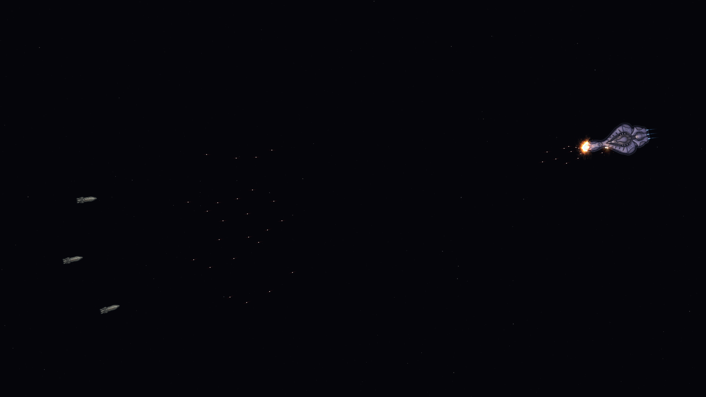
*Three Halberds open on a Covenant battlecruiser from 15,000 units out. One salvo lands on the bow while the next is already in the air. A real frame from build V56.*

Picture this: my friends and I are raiding an enemy planet on foot. We're overextended and getting overrun, barely holding on, and then another friend drops his fleet in out of nowhere and his fighters wipe the enemy out. That's the moment I'm building toward: one galaxy, one fight, with the commanders in the sky and the squads on the ground.

The long-term game is a **strategy + first-person hybrid**, and the first step is a real-time fleet strategy game. UNSC and Covenant fleets fight across a living galaxy, and I'm working toward a six-player LAN session with friends this December.

## How it started

There wasn't one big night. I tried something small at work and was impressed, then tried a little project at home and was impressed again. Then I fell off a cliff: designing workflows, generating ship art, writing battle plans, building galaxy generation, tuning flow fields. The first battle sim ran on **1 September 2026**: triangles shooting at each other. Two months and 50+ builds later, it looks like this:

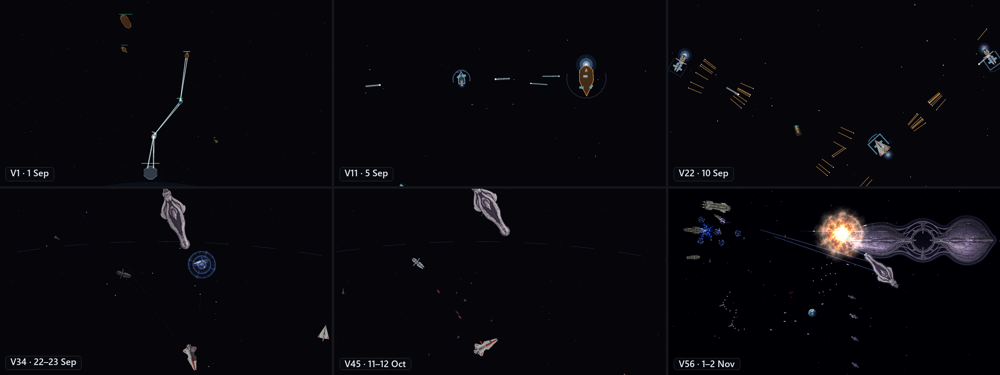
*The same game, two months apart: a battle in progress in V1, V11, V22, V34, V45 and V56, each running the fight that build could stage.*

## What I care about: depth

If I click and it doesn't feel like I actually clicked, or an action doesn't feel like it mattered, the game feels shallow, and I'm out. My friends and I are picky about games together. So in Reach, ships have weight, shots land on shields and hulls, and when a ship dies it comes apart along its real seams. Every order is meant to feel heavy.

## What it's like to play

You command a faction's fleets and stations across a 30-system galaxy. On the galaxy map you route fleets along hyperlanes. Zoom into a system and the same fleets fight it out live, ship by ship. It's one game at every zoom level, with no loading into a separate battle screen.

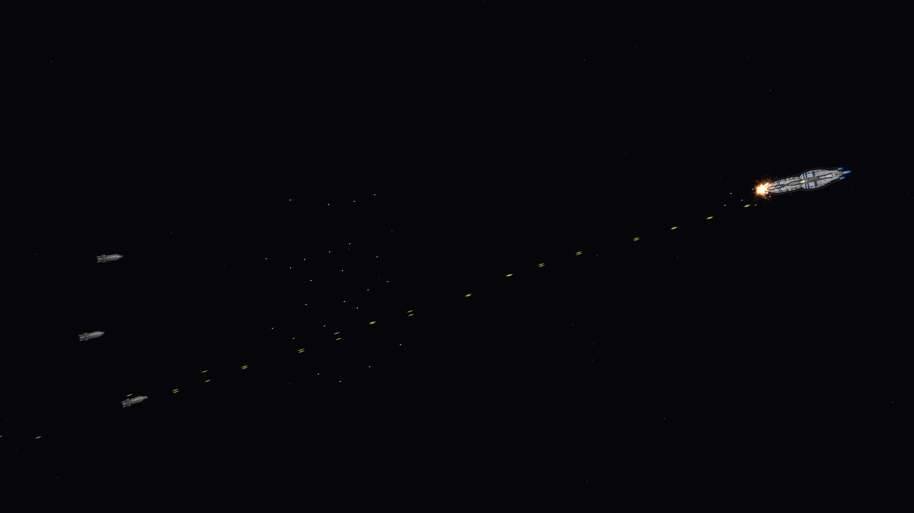
*The same three Halberds against a CIS Providence. The Archers cross one way while the Providence fires back down the same line.*

**In the build today**
- **Fleets that feel heavy.** Ships turn, drift and hold formation with momentum. In-system they micro-jump in straight lines, until an interdictor rips them out of jump.
- **Combat with real weapons.** UNSC MAC rounds fire straight off the bow, and Archer missiles arc in from long range. Covenant shields soak hits until they collapse. Point defence screens missiles, and fighter and bomber swarms launch from real hangar bays. The Epoch and Halcyon carry nukes.
- **Ships that die properly.** No health bar hitting zero and a sprite vanishing. Hulls break apart along their actual seams, carrying the damage they took, with momentum, fire and venting.
- **Salvage as a way to play.** Tugs latch onto the wreckage, tow the biggest pieces home first, and turn a battlefield into resources for your shipyards.
- **Admirals.** Commanders with traits, ranks and morale. Lose ships and morale drops. Push too far and they'll pull the fleet back.
- **Stations and shipyards.** Place, build and upgrade outposts and yards that actually build your ships.
- **Fog of war.** Sensors, sight ranges, nebulae that hide what's inside, and contacts you can't quite identify.
- **Pirate strongholds.** Fortified platforms with torpedo racks and fighter hangars that stop early fleets from sweeping the map.
- **A sandbox.** Drag ships onto a test field, tune any weapon or hull number live, and watch the fight change.

**Coming for the December playtest**
- Six players at once over LAN, for a three-hour session
- Planet capture and territory: planets are the big resource engines and the way you hold a system
- NPC factions with their own high command, expanding and fighting on their own
- A short tutorial so my friends can jump straight in

## In motion

| | | |
|---|---|---|
| 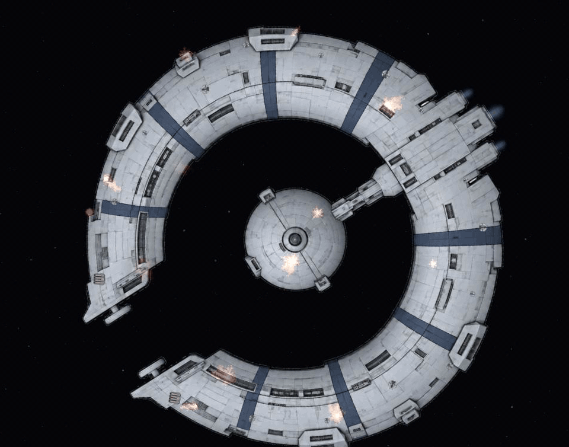 | 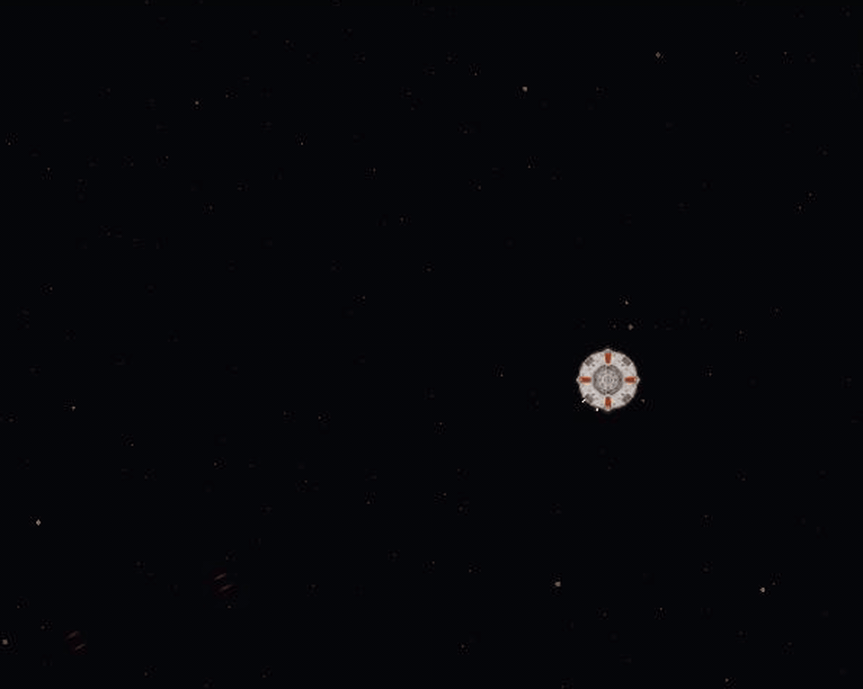 | 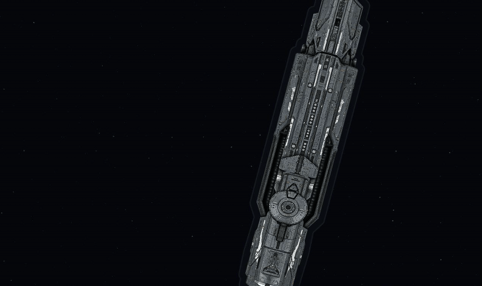 |
| *A Lucrehulk battleship cracks apart along its hull seams* | *A nuclear warhead detonates against an enemy station* | *A battleship opens a jump portal and drops back in (transit trimmed)* |

## The first-person side

The strategy game is the first half. I've started the second half beside it: a first-person prototype in Godot. You walk the Spirit of Fire's hangar, drive a rover across the deck, fly a dropship and a Seraph, and trade fire with a Covenant frigate holding station alongside. Next comes a 3D slice where both ships are flyable and boardable. All of it is an early prototype.

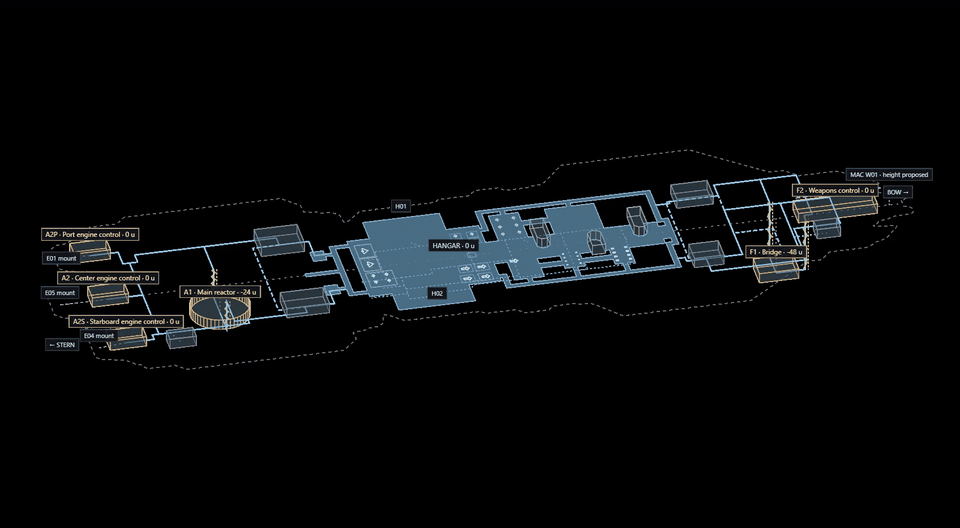
*Early prototype: a rotating 3D study of the Spirit of Fire's deck layout, with heights exaggerated four times.*

| | |
|---|---|
| 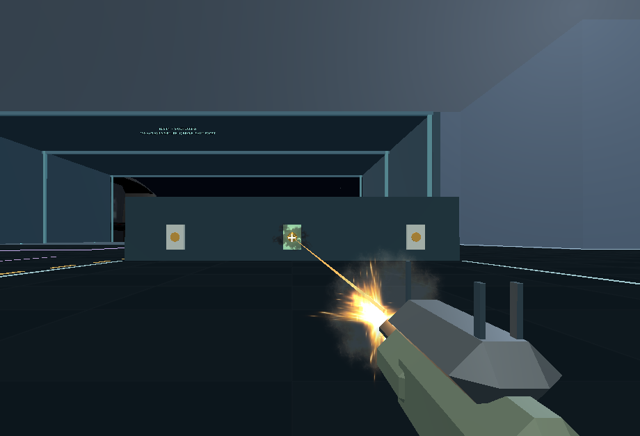 | 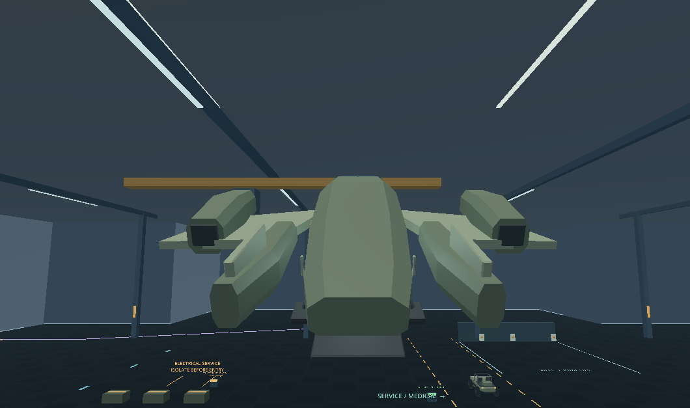 |
| *On foot in the hangar, at the firing range* | *Flying a dropship inside the 36 m hangar* |
| 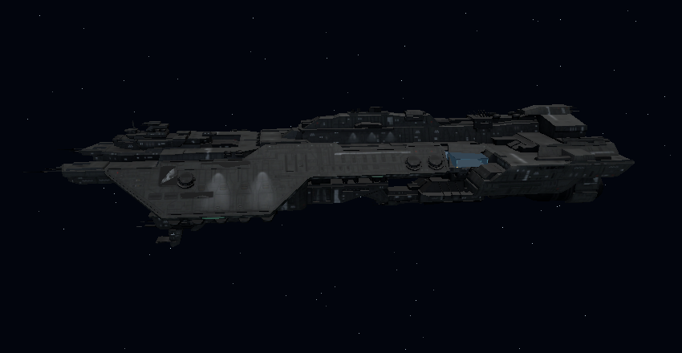 | 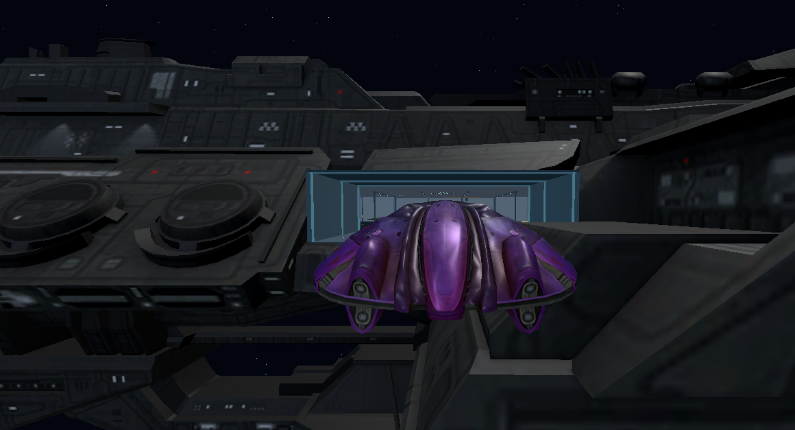 |
| *The Spirit of Fire from outside* | *A Seraph heading back into the hangar opening* |
| 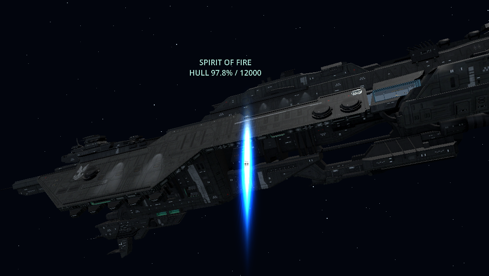 | 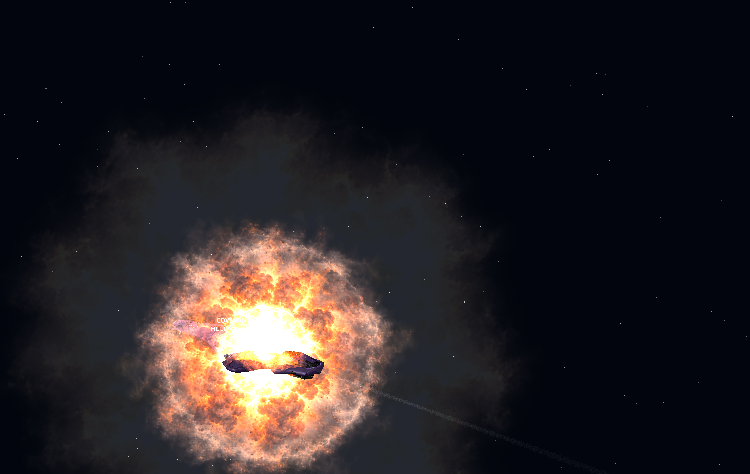 |
| *Live plasma fire striking the Spirit of Fire's hull* | *A nuclear missile detonating on the Covenant frigate* |

*All of these are early prototype. Some ship models in these shots come from the* Sins of the Prophets *mod, with credit to its authors.*

## When I'll be proud of it

Honestly, I'm not proud of Reach yet. The battle sim is a step. I know what proud feels like, though. I designed a Lord of the Rings strategy board game, and on its third playtest, about an hour in, my friends stopped being patient with me and started plotting against each other: whispering tactics, bluffing, laughing and yelling. That's the bar. When the December playtest has that hour, I'll be proud of it.

## How I build it

I'm a mechanical engineer, not a career programmer. Reach is built with a team of AI agents: Claude Code writes most of the code, and an AI art lead produces the ship and station art. I'm the director. I design the game, make every call, play every build and decide what stays.

- **Decide before building.** Design gets talked through, often by voice on my drive home, and locked before any code. Every build starts with a list of the assumptions it would make, and I strike the wrong ones first.
- **Overnight builds.** A lead agent plans and merges while several helper agents build in parallel, usually while I'm asleep or at my day job. I wake up to a one-page brief.
- **Nothing is done until I've played it.** A feature only counts as approved after I've seen it working in a build and said yes.
- **Measure it.** Automated checks catch breakage before I load the game, and a daily report tracks progress toward the December playtest.

More in [`docs/how-we-build-it/`](docs/how-we-build-it/): the full loop, the skills our agents use, and real examples of a build plan, a design-decision record and an overnight brief. The day-by-day history is in [`docs/timeline.md`](docs/timeline.md).

Under the hood:
- **Godot 4 / GDScript**, with Python tooling.
- **A pure, headless simulation** kept separate from rendering and UI. Tests fail the build if that line is crossed.
- **Deterministic battles.** The same inputs always give the same fight, checked every build. That's also what makes lockstep multiplayer possible.
- **Data-driven ships.** Each hull carries its own hardpoints, docking points and break-apart seams, so new art drops in without code changes.

## By the numbers

| | |
|---|---|
| First battle sim | 1 September 2026 |
| Builds | 50+ numbered builds |
| Test battles simulated | 2,283 since 16 October, when the counter went in |
| Shots fired in those battles | ~21 million |
| Ships destroyed | 4,763 |
| Fighters and bombers launched | ~288,000 (~241,000 shot down) |
| Hand-written code | ~500,000 lines of GDScript, tests and tools |
| Commits | 289 |

*(From the game's own stats file and repository, 2 Nov 2026.)*

## The code

The source is in a separate private repository. If you're reviewing my work and would like to read it, send me your GitHub username and I'll add you.

## About me

I'm Costa Camerano, a mechanical engineer (MS, Boston University) and lead mechanical engineer on a sub-250 g coaxial drone. I build games for my friends.

---

*Project Reach is a non-commercial fan project. Halo and Star Wars and their related names are trademarks of their respective owners. No art or audio assets from either are published here; screenshots show the game running. Text and images © 2026 Costa Camerano, all rights reserved.*
