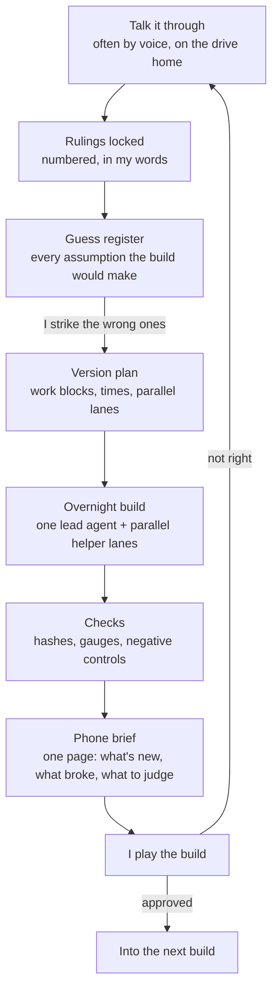

# How we build it

Project Reach is built by one person directing a team of AI agents. I design the game, make every call and play every build. Claude Code writes most of the code, and an AI art lead produces the ship, station and effect art. This page is the loop we run, build after build.

## The loop

1. **Talk.** A design question gets talked through before any code, usually out loud in the car. Claude prepares the questions beforehand and researches instead of guessing.
2. **Rulings.** What I decide gets written down as numbered rulings, with my own words beside each one. The record is append-only, so a later change is a new ruling and the old one stays visible.
3. **Guess register.** Before a build starts, every assumption it would otherwise make silently gets listed with a default and a confidence level. I strike the wrong ones. An open design question is asked as a short multiple choice with the trade-offs written in.
4. **Version plan.** The work is cut into plain blocks with time estimates and the lanes that can run side by side, with a Gantt chart so I can trim scope before anything is built.
5. **Overnight build.** A lead agent plans, merges and checks. Several helper agents each build one part in their own copy of the tree. The lead folds their work back together as each one finishes. This usually runs overnight.
6. **Checks.** Nothing counts as done until it has run. Every new mechanism gets a gauge, and every gauge gets a negative control (a defect planted on purpose that it must catch). The simulation is deterministic, so a set of battle hashes must match exactly unless a change is a deliberate, documented re-record.
7. **Phone brief.** The build ends with a short brief I can read on my phone: what's in it, what broke, what's still a stand-in, and exactly what to look at.
8. **I play it.** A feature is approved only after I've seen it working in a build and said yes. "Approved" means good for now, not frozen.

## The rules that keep it honest

- **A build never overwrites the one before it.** Every build is a full copy of the last one plus its changes, so the previous build is always there as the control to compare against.
- **Every new feature ships behind a switch.** With all the new switches off, a build reproduces the build before it, and a tool walks the switches one at a time to prove it.
- **Missing art doesn't stop a build.** A gap is filled from the nearest approved relative, marked on screen as a stand-in, and listed in the build's gap register until the real thing arrives.
- **Measure, don't predict.** Performance and memory are measured on the reference PC. Free memory decides how many test runs go at once.
- **Decisions taken without me are written down** with how to reverse each one.

## The five-build cadence

Most builds run a lean core check: the hashes, save and resume, architecture rules, the menus, and each new feature's own gauges. Every fifth build (V45, V50, V55, …) is a proper build, with the full timing checks on a quiet PC. This page is refreshed on the same rhythm.

## The art lead

Ship, station, weapon and effect art comes from an AI art lead named Astra, working in its own workspace from written briefs. Each brief starts with a sweep of what already exists, so nothing is re-briefed by accident. Astra delivers versioned art packages. Each package carries everything the game needs to put the object in the world: sprite, size, pivot, hull outline, collider, hardpoints, docking points and break-apart seams. Swapping a ship's art means swapping its package, with no code change. I approve the art. Rejected work goes back with written feedback.

## Model tiers

| Tier | Job |
|---|---|
| Lead | Plans the build, writes the shared contracts, folds the lanes together, runs the checks, writes the brief |
| Helpers | One lane each, in their own copy of the tree, building and testing one feature |
| Chores | Small mechanical jobs: indexes, copies, tidying |

## More

- [The skills our agents use](skills.md), with why each one was made and how it changed
- [A real build plan](build-plan-example.md)
- [A real design-decision record](design-decisions-example.md)
- [A real overnight brief](overnight-brief-example.md)
