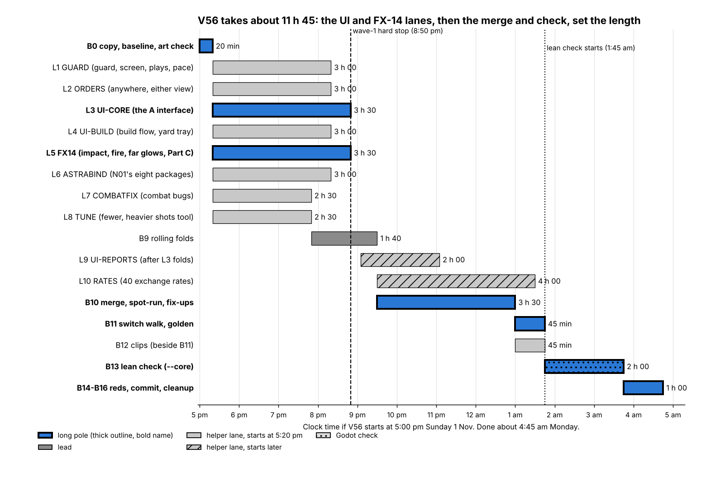

# V56 version plan (1 Nov 2026)

*A real project document, lightly edited for privacy. Internal file names and IDs are left in to show the record-keeping; the files themselves aren't public.*

For Costa to trim. Everything here is fiction (a video game).
- **Gantt chart:** [`build-plan-gantt.png`](build-plan-gantt.png) beside this file.
- **Scope:** the build's master list. It holds your V55 and V55_1 notes, today's Astra work (N01, FX-14, the A UI) and the V55_1 leftovers.

## Headline
- **If V56 starts at 5:00 pm, it's committed at about 4:20 am Monday and cleaned up by about 4:45 am.** That's about 11 h 45 of real time.
- **It starts from the committed V55_1** (950d5fba). It runs the lean check set, not the full sweep.
- **The times are estimates checked against V55_1's real night** (31 Oct–1 Nov):
  - its 14 helpers landed in 1 h 49 to 3 h 31, mostly over plan;
  - its merge and fix-ups took 4 h 47, against 2 h planned;
  - its switch walk took 41 min, its clips 43 min, its lean check 1 h 57.
  - So every helper here gets a 3 h 30 hard stop, and the merge gets 3 h 30.

## At a glance
Eight helpers start together after a 20-minute setup. Two more start later: the report bars, once the main UI is folded in, and the exchange rates, once the combat lanes are folded in. Then the lead merges, walks the switches and runs the lean check. Your tuning session for "fewer, heavier shots" comes the next day, with you.

**The long pole is the first wave, then the merge, then the check.** The two biggest helpers, the A UI (L3) and FX-14 (L5), run to their 3 h 30 stops. The merge after them is the longest single block, and it grows with the number of lanes and reds.
- **What shortens the night:** fewer lanes in wave 1, or a smaller UI lane. A smaller merge ends sooner.
- **What doesn't:** cutting the report bars (L9) or the exchange rates (L10). Both run in the merge's shadow, so cutting them frees a helper but ends no sooner.

## The blocks, in plain words

**B0 · Copy V55_1, baseline, read today's art (lead, 20 min).**
- **What it does:**
  - copies the committed V55_1 into V56 and checks the ten hashes;
  - checks today's accepted Astra packages byte for byte: FX-14's ZIP and N01's eight packages;
  - makes the helper copies.
- **What you'll see:** nothing.
- **Why:** every build starts this way.
- **History:** V55_1's B0 took 15 min.
- **Cut it?** No.

**L1 · GUARD: guard, screen and the plays (helper, 3 h).**
- **What it does:**
  - **Guard and Screen are standing tasks.** They stay on after you deselect, until you change them.
  - **Guard spreads itself.** PD ships pick a valuable ship and spread across ships, unless you click Guard and then a ship.
  - **Guards stay close** to their ship, not "far away and behind", and their station stays out of friendly fire lines.
  - **Bodyguard and Raider really differ.** In V55_1 both lined up in front of the Epoch.
  - **A guarded fleet moves at its slowest ship's pace**, so it arrives "as one full force". The zoomed-out model uses the same pace, so both views agree.
- **What you'll see:** PD frigates hugging the ship they guard, raiders acting like raiders, and fleets arriving together.
- **Why:** your 1 Nov rulings on guard, screen and pace; review answers 13 and 14.
- **History:** V55_1's FLEETINFO took 3 h 12, plus the FIXD follow-up on the guard stall. A guess.
- **Cut it?** No.

**L2 · ORDERS: send a fleet anywhere, from either view (helper, 3 h).**
- **What it does:**
  - select a fleet, zoom into another system and right-click anywhere: it travels there, to that exact point;
  - right-click a planet on the galaxy map: it goes to that system's jump point and waits;
  - the map accepts G (guard), J (jump) and Shift+F like the system view;
  - X cancels a charging jump; a plain click cancels a galaxy trip (Shift still queues);
  - map fixes:
    - the bodies card no longer blocks clicks on the next world;
    - the card names the body, not just the world;
    - stations are listed on the card;
    - wheel zoom on a fleet marker works;
    - no more stutter when zooming over a fleet icon;
    - the planet panel and the FIRST OUTPOST banner close when they should.
- **What you'll see:** "one game": the same order works from either view.
- **Why:** review answers 1, 18 and 19; Rule 10; your V55 hover-stutter bug.
- **History:** V55_1's ANYWHERE took 1 h 52, QUEUE 2 h 04, SAMEPLAN 1 h 49. A guess.
- **Cut it?** Partly. The map polish could wait, but it's small and doesn't shorten the night.

**L3 · UI-CORE: the A interface (helper, 3 h 30; part of the long pole).**
- **What it does:** builds Astra's A design from her design handoff, as its pictures and contracts say:
  - the resource ribbon across the top;
  - one command dock at the bottom left: ship and condition, its current task, then its actions;
  - shield and hull bars and a picture of the selected ship;
  - the Guard/Screen dropdown;
  - text 9–12 px, buttons at least 28 px;
  - your faction's light colour on the frame, selection still white;
  - low-value detail moves to Inspect.
- **It also makes UI scale a release check:** 1x/1.5x/2x hold across a monitor move, which fixes your huge-HUD-in-Tests bug.
- **What you'll see:** the new UI in all four factions, in both views.
- **Why:** you picked A, approved the compact M11 and liked the faction examples today.
- **History:** none for a UI this size. A guess, so it gets the full 3 h 30 stop with a cut list: dock and bars first, Inspect last.
- **Cut it?** Partly: Inspect polish can trail into V56_1.

**L4 · UI-BUILD: building and the yard queue (helper, 3 h).**
- **What it does:**
  - pick a site, see a white unpaid ghost, then accept; cancelling first is free;
  - the compact M11 yard tray at the bottom right, with real queue, progress and refund;
  - the small overview panel beside it.
- **What you'll see:** the new build flow and yard tray.
- **Why:** part of the A design you approved.
- **History:** none. A guess.
- **Merge risk:** it shares the HUD with L3. The handoff splits them by file: build and yard files here, the dock and theme in L3.
- **Cut it?** Partly. It could follow in V56_1, but it doesn't shorten the night.

**L5 · FX14: siege impact, fire zones, far glows, the new bolt hit (helper, 3 h 30; part of the long pole).**
- **What it does:**
  - **Binds Astra's FX-14 package** (sha-checked):
    - siege impact A;
    - the three 15-second fire zones;
    - far glows for six shot types, nuke brightest, with your R2 steady look and the centred backlight;
    - a clean hand-off between the close look and the far look.
  - **Makes the fire zones burn fighters that fly through them.** No numbers were ever set, so the first ones are guesses you tune on the bench.
  - **Replaces the purple plasma-bolt hit with Part C**, built from Astra's approved source and matched to her approved movie: a varying angle per hit, 0.65 s.
- **What you'll see:** heavy shots visible from far away, the new siege impact, and the new bolt hit.
- **Why:** your far-glow ruling, FX-14's approvals today, and Part C ("Yes, I like it").
- **History:** V55's SIEGEFX took about 3 h. A guess.
- **Cut it?** The burn damage could stay OFF (visual only) and save about 30 min, but that isn't the long pole on its own.

**L6 · ASTRABIND: today's N01 art (helper, 3 h).**
- **What it does:** binds the eight N01 packages you accepted today:
  - damage 8A puffs, beside DMG-01's lasting smoke;
  - the new nuke wake, which ends the "line of little explosions";
  - the beam contact and hull heat, matched to her stills and ON if they match;
  - the Subjugator ion ring's art, so the ion guns can go ON under the rules you approved on 29 Oct;
  - real canopies for the CIS Citadel and the two pirate platforms;
  - three station hit outlines.
- **It also:**
  - removes the old pale-blue engine glow from every non-UNSC, non-Covenant ship, with no stand-in (Rule 5);
  - checks which hulls lack damage marks (the Subjugator).
- **What you'll see:** all of the above, plus no more blue circles behind the Subjugator.
- **Why:** your N01 approvals today and your Subjugator notes.
- **History:** V55's FX11PORT plus INHERIT took about 3 h. A guess.
- **Cut it?** No.

**L7 · COMBATFIX: the combat bugs (helper, 2 h 30).**
- **What it does:**
  - makes the in-battle shield rate (x0.1) work on the bench, the same as in the game;
  - stops the Citadel turning 90° when placed;
  - makes Covenant projector beams reach the target at full range;
  - lets PD shoot down Archer missiles;
  - makes the Covenant pulse laser real PD;
  - builds your 12 px weapon draw-size rule.
- **What you'll see:** fixes to bugs you found.
- **Why:** your V55 and V55_1 play notes.
- **History:** V55_1's BUGFIX took 3 h 22. A guess.
- **Cut it?** No.

**L8 · TUNE: the tool for "fewer, heavier shots" (helper, 2 h 30).**
- **What it does:**
  - a bench control per gun family: fewer shots, more damage a shot, same damage per second;
  - a readout of how many shots are on screen;
  - the PD table's Run button.
- **Your numbers get set with you** in a session the next day. Nothing is changed in the game data overnight.
- **What you'll see:** a slider on the Sandbox stats page.
- **Why:** your 2A today.
- **History:** none. A guess.
- **Cut it?** No; it's the tool for your tuning session.

**L9 · UI-REPORTS: briefing and contact bars (wave 2, 2 h, starts after L3 folds).**
- **What it does:**
  - the fold-open report and contact bars from the A design, closed by default;
  - they never issue or cancel orders.
- **Where nothing real feeds them yet** (objectives, payouts), they stay a labelled Tests preview.
- **What you'll see:** the bars in the system view.
- **Why:** part of the A design.
- **History:** none. A guess.
- **Cut it?** Yes, if you want: it doesn't shorten the night.

**L10 · RATES: the other 40 exchange rates (wave 2, up to 4 h, starts at the merge).**
- **What it does:** measures the 40 pairings V55_1 didn't reach, on the merged combat changes.
- **What you'll see:** a fuller TABLES tab.
- **Why:** your yes on exchange rates (31 Oct).
- **History:** V55_1 measured 9 in about 3 h, at 1.0–1.5 GB each. It stops before the lean check and prints what it has.
- **Cut it?** Yes; it doesn't shorten the night.

**B9 · Rolling folds (lead, while lanes land).** Each lane is folded into the lead tree as it lands, with its own checks.

**B10 · Merge, spot-run, fix-ups (lead + helpers, 3 h 30).** All lanes together, then fix whatever goes red. V55_1's took 4 h 47 with 14 lanes; this one has 10.

**B11 · Switch walk, golden (lead, 45 min).** V55_1's took 41 min. Expected hash moves:
- the guard pace;
- the Archer PD and the pulse laser;
- the ion guns ON;
- the fire-zone burns.

**B12 · Clips (helper, 45 min, beside B11).** Short clips for your phone, filmed after the fix-ups so nothing is stale. V55_1's took 43 min.

**B13 · Lean check (Godot, 2 h).** V55_1's took 1 h 57.

**B14–B16 · Reds, commit, cleanup (lead, 1 h).** V55_1's took about 30 min in all.

**After: your tuning session (with you, about 1 h, the next day or later).**
- You set "fewer, heavier shots" and the burn numbers on the bench, and say them in chat.
- A Sandbox revision of V56 commits them (project rule: bench edits are kept only when you say so).

## Where I'd push back
- **L9 report bars:** most of what they'd show (objectives, payouts) has no real game data behind it yet, so tonight they'd be mostly a preview. Cutting them frees a helper; it doesn't shorten the night.
- **L10 exchange rates:** pure measuring. It could run any night. Same: it doesn't shorten the night.
- **The ion guns going ON:** that changes battles with a Subjugator in them. Your 29 Oct rules are approved, but a few timings were never set (the guess register lists them). If you'd rather see it first, it ships built but OFF.
- **What would actually shorten the night:** a smaller A UI tonight (core dock and bars only; build flow and yard tray in V56_1). That removes a lane from the merge and trims about 20–30 min.

## Planned vs actual (filled in at the version review)
| Block | Lane | Planned | Actual | Landed? |
|---|---|---|---|---|
| B0 copy, baseline, art check | lead | 20 min | 16:42–17:14 (32 min, incl. the hook hashes) | yes |
| L1 GUARD | helper | 3 h | 17:00–20:28 (3 h 28; + FIXGUARD 21:49) | yes, folded 20:47 |
| L2 ORDERS | helper | 3 h | 17:00–20:32 (3 h 32; + FIXORDERS 22:13) | yes, folded 21:05 |
| L3 UI-CORE | helper | 3 h 30 | 17:00–20:09 (3 h 09) | yes, folded 21:51 |
| L4 UI-BUILD | helper | 3 h | 17:00–20:06 (3 h 06) | yes, folded 22:29 |
| L5 FX14 | helper | 3 h 30 | 17:00–20:30 (3 h 30) | yes, folded 21:51 |
| L6 ASTRABIND | helper | 3 h | 17:00–20:31 (3 h 31; + FIXASTRA 23:04) | yes, folded 21:05 |
| L7 COMBATFIX | helper | 2 h 30 | 17:00–20:33 (3 h 33) | yes, folded 20:47 |
| L8 TUNE | helper | 2 h 30 | 17:00–20:12 (3 h 12; + FIXTUNE) | yes, folded 20:15 |
| L9 UI-REPORTS | wave 2 | 2 h | 21:55–23:29 (1 h 34) | yes, folded 23:44 |
| L10 RATES | wave 2 | up to 4 h | 21:55–01:15 (3 h 20, stopped for B13) | partly: 26 of 40, folded in B14 |
| B9 folds | lead | during lanes | 20:15–22:56 (folds and their checks) | yes |
| B10 merge, fix-ups | lead + helpers | 3 h 30 | 23:02–23:46 (44 min; fix-ups overlapped B9) | yes |
| B11 walk | lead | 45 min | 23:46–00:46 (1 h) | yes |
| B12 clips | helper | 45 min | 23:50–00:47 (57 min) | yes; 6 weak, 2 missing |
| B13 lean check | Godot | 2 h | 00:47–02:58 (2 h 11) | yes: FAIL, 14 red |
| B14–B16 reds, commit, cleanup | lead | 1 h | 02:58– (B14 to 04:01, commit 04:03; end in V56_DONE.txt) | B14 and B15 yes |
| Tuning session | with Costa | about 1 h | | |

## IDs named here
| ID | What it is |
|---|---|
| V55_1, V56 | The point build you just reviewed (950d5fba); this build |
| L1–L10, B0–B16 | This build's helper lanes and lead blocks |
| N01 | Astra's open-asks session: eight packages accepted today |
| FX-14, Part C | Astra's siege impact and far glows (Stage 2 delivered today); the plasma-bolt hit (visual approved) |
| A UI, M11 | Astra's interface design you picked today; its compact yard queue |
| R-ZL-1 | Your 12 px weapon draw-size rule |
| Rule 5, Rule 10 | No stand-ins; one game |
