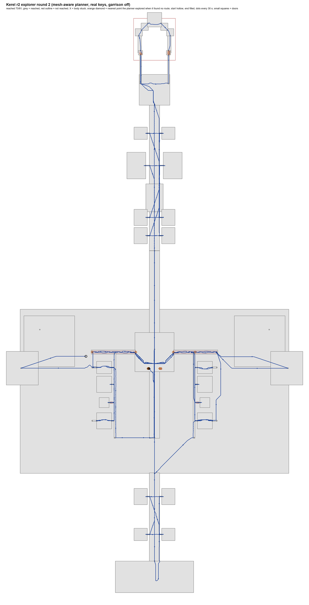

# Diagnosis night · 22 Nov 2026

No build tonight, just finding out why things break before fixing anything. That's the rule from now on. Got five answers: why the Kerel garrison never shot back (an old spawn line dropped every squad on one spot), three reasons stacked up so the Spirit of Fire wave never fought, how many soldiers each ship holds at 60 fps, which of the Kerel's 81 rooms you can really walk to, and what switching physics engines would buy us.

*Which Kerel rooms a bot could reach with real keys.*
